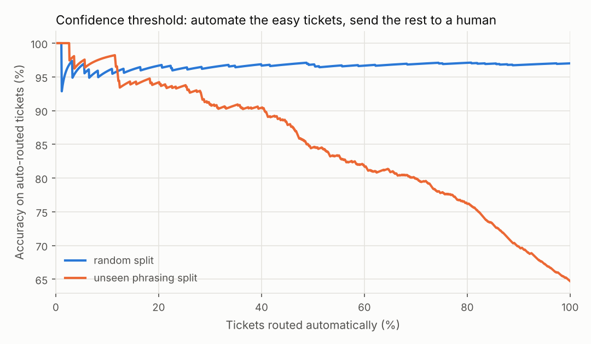
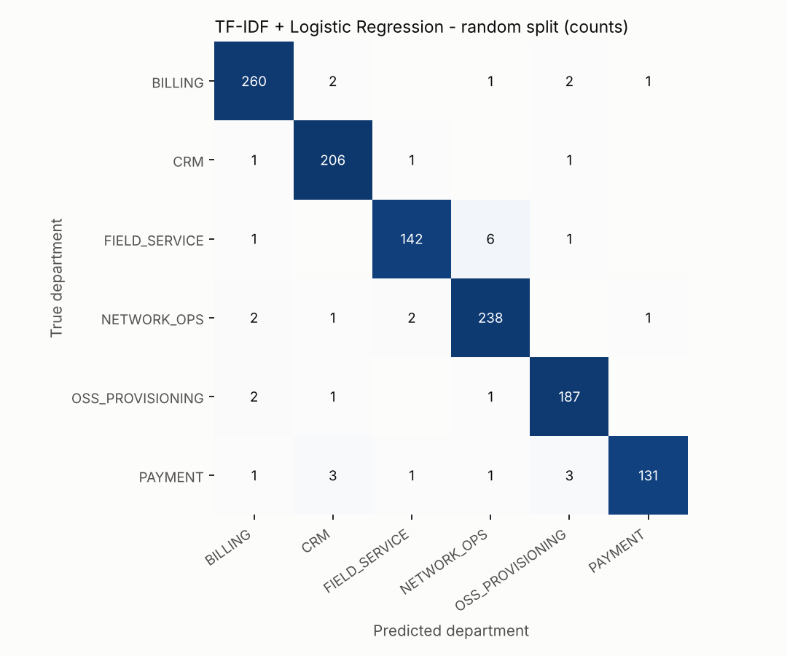
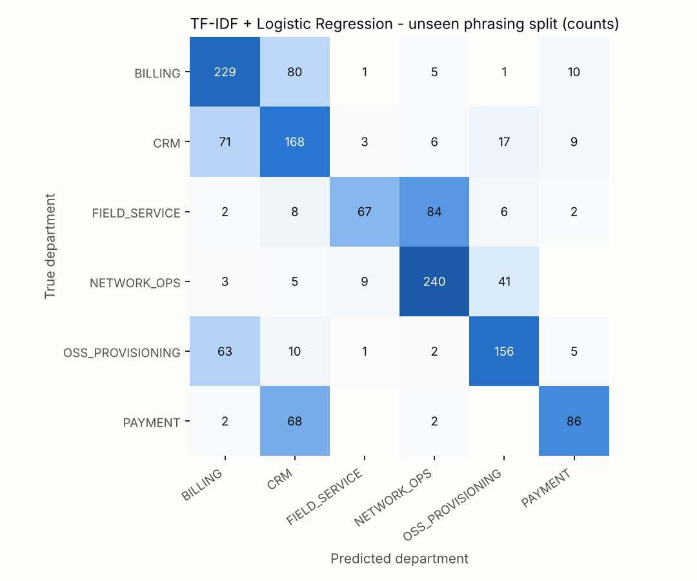

# Automated Telecom Ticket Classification

Route free-text customer-service tickets to the right resolver department automatically, and know when **not** to trust the model.

  

## Why this project

From 2020 to 2024 I worked on the ITSM desk of a provincial telecom operator, where front-line customer-service agents wrote tickets that had to be routed to the right resolver group (CRM, billing, OSS provisioning, network, …). Routing was done by people, and a mis-routed ticket loses time against its SLA while it bounces between teams.

This project asks: **how much of that routing can a text classifier do, and how should it hand the rest back to a human?**

## Results at a glance

| Model | Random split<br>macro-F1 | Time split<br>macro-F1 | **Unseen phrasing**<br>macro-F1 |
|---|---:|---:|---:|
| Majority class (baseline) | 0.061 | 0.058 | 0.061 |
| TF-IDF + Random Forest | 0.965 | 0.970 | 0.523 |
| **TF-IDF (word + char) + Logistic Regression** | **0.969** | **0.974** | **0.636** |
| BERT fine-tuning (extension) | — | — | *script provided, see below* |

Three findings matter more than the headline number:

1. **The model is right more often than the historical labels.** On the random split the model makes 36 errors out of 1,200. In **all 36** the ticket text clearly belongs to the department the model predicted — the *label* was wrong (the dataset contains 3% mis-routed tickets, as real logs do). A routing model doubles as a tool to find mis-routed tickets.
2. **High accuracy on a random split is partly memorisation.** When whole phrasing patterns are held out of training (`unseen_phrasing_split`), macro-F1 drops from 0.97 to 0.64. This is the realistic risk when a new product launches or new agents write differently.
3. **A confidence threshold turns a 65% model into a useful one.** On unseen phrasings, auto-routing only the most confident 41% of tickets keeps accuracy ≥ 90%; the rest go to manual triage.



## Data

Real operator tickets contain customer personal data and are never published, so the dataset is **synthetic**, generated by [`data/generate_tickets.py`](data/generate_tickets.py) to reproduce the shape of the real routing problem:

- **6,000 tickets**, 6 departments with an imbalanced class prior
- English free text in agent shorthand (`cust`, `pls`, typos, ALL-CAPS, inconsistent punctuation)
- **Cross-department side remarks** that add misleading keywords (a CRM ticket that also says *"customer already paid the bill"*)
- Generic filler (`urgent!!`, `VIP customer.`, `escalated by supervisor.`)
- **3% label noise** to imitate historically mis-routed tickets

| Department | Typical ticket |
|---|---|
| `BILLING` | *monthly fee still deducted after family bundle cancelled October* |
| `CRM` | *order for 199 plan stuck in 'pending review' status for 3 days* |
| `OSS_PROVISIONING` | *new SIM activated in CRM but HLR not updated, no service* |
| `NETWORK_OPS` | *fiber very slow at night in Beilin, speed test far below plan* |
| `PAYMENT` | *topped up 50 via WeChat but balance not updated* |
| `FIELD_SERVICE` | *installation appointment for fiber missed, technician did not show* |

The generator is deterministic (`--seed`), so every number in this README can be reproduced.

## Method

```
ticket text ─► clean_text ─► TF-IDF word 1–2-grams  ─┐
                           └► TF-IDF char 3–5-grams ──┴► Logistic Regression ─► department + confidence
                                                                                   │
                                                          confidence < threshold ──┴► MANUAL_TRIAGE
```

- **Word n-grams** capture key phrases (`not activated`, `monthly fee`); **character n-grams** make the model robust to typos (`custmer`, `recieved`).
- **Three evaluation splits** — each answers a different question:
  - `random_split` (stratified 80/20): the standard benchmark
  - `time_split` (train on older tickets, test on the newest 20%): does it still work next month?
  - `unseen_phrasing_split`: 3 of the 12 phrasing templates per department are held out entirely, so test tickets describe problems in ways never seen in training
- **Regularisation chosen with grouped cross-validation.** With ordinary k-fold, every value of `C` scores ≈0.97, because train and validation folds share phrasings. Grouping folds by phrasing template rewards generalisation instead; it picked a strongly regularised `C = 0.03`, which raised unseen-phrasing macro-F1 from 0.591 (with `C = 5`) to 0.636.

### Where the model gets confused

On unseen phrasings, errors concentrate between departments that really do overlap — `BILLING ↔ CRM`, `OSS_PROVISIONING → BILLING`, `PAYMENT → CRM`, `NETWORK_OPS → OSS_PROVISIONING` and `FIELD_SERVICE → NETWORK_OPS` (an on-site fault and a network fault are described with similar symptoms).

| Random split | Unseen phrasing split |
|---|---|
|  |  |

Most predictive n-grams per department are listed in [`reports/top_features.md`](reports/top_features.md); mis-routed examples are in [`reports/error_examples.md`](reports/error_examples.md).

## Extension: BERT fine-tuning

A pretrained language model knows that *"balance not updated"* and *"credit didn't arrive"* mean similar things, so it is the natural next step for the unseen-phrasing gap. [`src/ticket_routing/bert_finetune.py`](src/ticket_routing/bert_finetune.py) fine-tunes any Hugging Face encoder (default `bert-base-uncased`) with a plain PyTorch training loop (AdamW, linear warm-up/decay, gradient clipping).

```bash
pip install -r requirements-bert.txt
python -m src.ticket_routing.bert_finetune --split unseen_phrasing_split   # GPU recommended (e.g. Colab)
python -m src.ticket_routing.bert_finetune --smoke-test                    # offline CPU check of the loop
```

> **Status:** the training loop is tested offline with `--smoke-test` (a tiny randomly initialised BERT — not a meaningful accuracy number). The full pretrained run has not been reported here yet; results will be saved to `reports/bert_<split>.json`.

## Quick start

```bash
git clone https://github.com/ruohanzhang826-art/telecom-ticket-classification.git
cd telecom-ticket-classification
pip install -r requirements.txt

python data/generate_tickets.py          # (re)create data/tickets.csv
python -m src.ticket_routing.train       # train, evaluate, write reports/ and models/
python -m pytest -q                      # 4 tests

python -m src.ticket_routing.predict "topped up 50 via wechat but balance not updated" \
                                     "bill is high and internet slow"
```

```
PAYMENT        top1=('PAYMENT', 0.711)      top2=('OSS_PROVISIONING', 0.073)  | topped up 50 via wechat but balance not updated
MANUAL_TRIAGE  top1=('NETWORK_OPS', 0.356)  top2=('BILLING', 0.145)           | bill is high and internet slow
```

Training all models on all three splits takes about 30 seconds on a laptop CPU; inference is ~0.1 ms per ticket.

## Project structure

```
├── data/
│   ├── generate_tickets.py     # synthetic dataset generator
│   └── tickets.csv             # generated dataset (6,000 tickets)
├── src/ticket_routing/
│   ├── data.py                 # loading, cleaning, the three splits
│   ├── models.py               # baseline pipelines
│   ├── train.py                # training, model selection, evaluation, reports
│   ├── predict.py              # CLI with confidence threshold → MANUAL_TRIAGE
│   ├── bert_finetune.py        # BERT extension
│   └── plotting.py
├── reports/                    # metrics.json, figures, top features, error examples
└── tests/
```

## Limitations and next steps

- **Synthetic data.** Template-based text is more regular than real tickets, which is why the random split looks almost solved. The unseen-phrasing split is the more honest estimate. The natural next step is to test on real, anonymised tickets.
- **Only text is used.** Real routing also depends on structured fields (product, channel, customer type) and on rules (e.g. outage reports in an area go straight to network operations).
- **Next:** report the pretrained BERT run; add multilingual input (Chinese / Japanese tickets, e.g. with a multilingual encoder); calibrate probabilities so the threshold maps to a target accuracy; active learning on the `MANUAL_TRIAGE` queue.

## Author

**Zhang Ruohan** — telecom ITSM (ticket triage and escalation, 2020–2024) → data analysis & machine learning.

## License

MIT
